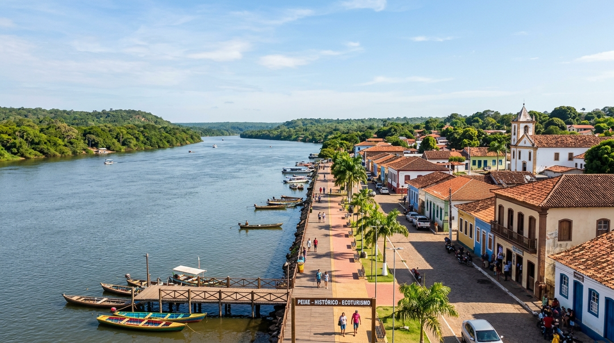
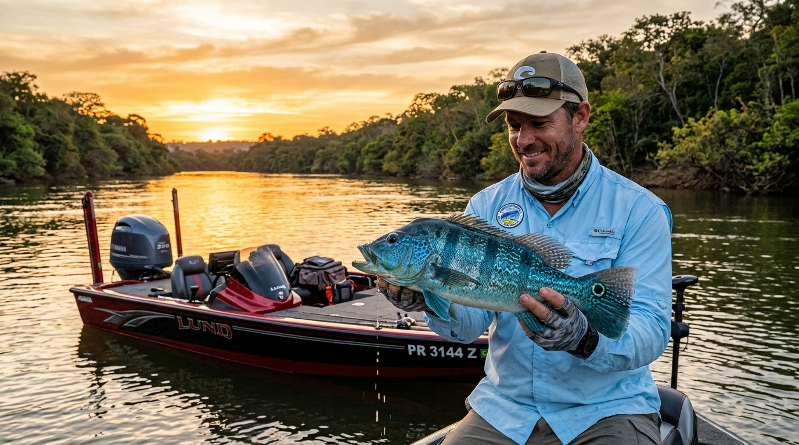
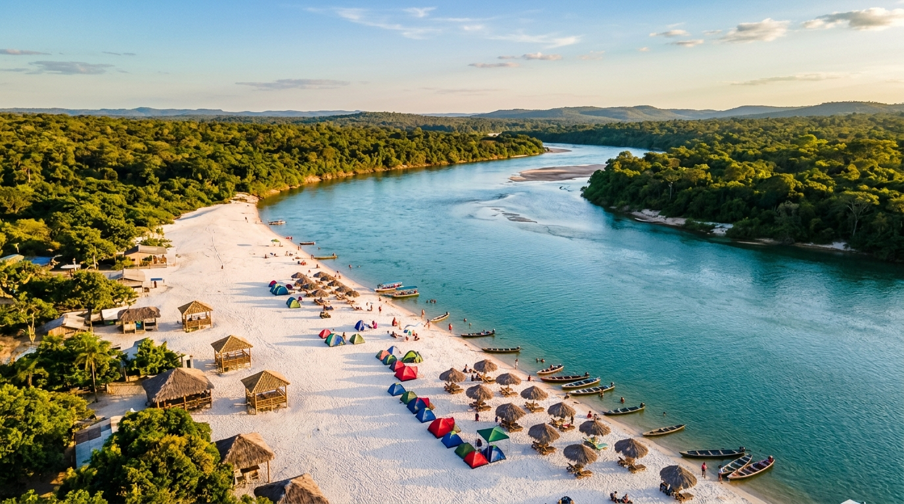
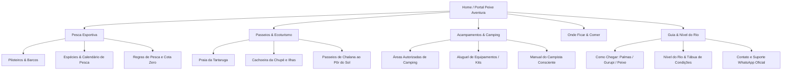
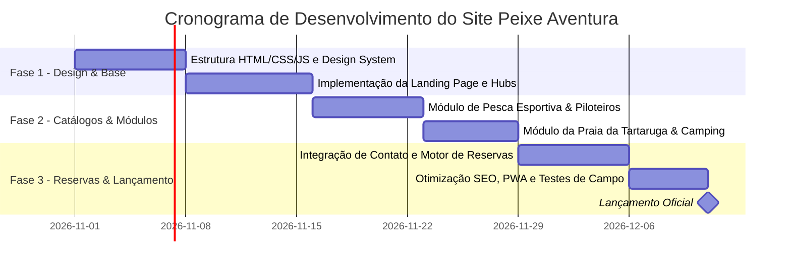

# 🎣 Product Requirement Document (PRD)
## Plataforma de Ecoturismo, Pesca Esportiva e Acampamentos em Peixe – Tocantins
**Nome Provisório do Projeto:** *Peixe Aventura Tocantins (Portal Peixe Ecotur & Pesca)*  
**Versão:** 1.0.0  
**Status:** Aprovado para Desenvolvimento  
**Data:** 21 de Outubro de 2026  
**Localidade:** Peixe – Tocantins, Brasil (Bacia do Rio Tocantins / Lago de Peixe Angical)

---

## 1. Visão Geral Executiva

O município de **Peixe**, localizado na região sul do estado do Tocantins, é um dos principais santuários ecológicos e mecas da pesca esportiva no Brasil. Banhada pelas águas majestosas do **Rio Tocantins** e pelo reservatório da UHE Peixe Angical, a cidade é célebre por suas praias fluviais de areias brancas (como a famosa **Praia da Tartaruga**), centenas de ilhas e canais navegáveis, além de ser o habitat privilegiado do lendário **Tucunaré Azul** (*Cichla piquiti*).

O objetivo deste projeto é construir uma **plataforma web completa, moderna, responsiva e de alta conversão** para centralizar todo o ecossistema turístico de Peixe-TO, promovendo e comercializando:
1. **Expedições de Pesca Esportiva:** Guias credenciados (piloteiros), barcos rápidos (bass boats), locação de tralhas e pacotes "pesque e solte".
2. **Passeios Turísticos e Ecoturismo:** Roteiros de chalana e voadeiras pela Praia da Tartaruga, Cachoeira da Chupé, passeios de pôr do sol e centro histórico.
3. **Acampamentos & Camping Fluvial:** Estrutura para camping nas praias e bancos de areia, glamping sustentável, aluguel de kits de acampamento e normas de segurança ribeirinha.
4. **Marketplace & Reservas Locais:** Pousadas parceiras, restaurantes de gastronomia tocantinense e comércio regional.

---

## 2. Galeria de Referência Visual do Destino

Abaixo estão os principais ativos visuais que representam a identidade do produto e devem compor a interface da plataforma:

### 2.1. A Cidade Histórica de Peixe e a Orla do Rio Tocantins
A cidade combina história secular, arquitetura colonial ribeirinha e um cais pulsante de onde partem os barcos e expedições fluviais.

*Legenda: Orla de Peixe (TO) ao longo do Rio Tocantins, ponto de partida das travessias e pescarias.*

---

### 2.2. Pesca Esportiva de Alto Rendimento no Rio Tocantins
O Rio Tocantins em Peixe é consagrado nacionalmente pela abundância de Tucunaré Azul, Surubins, Jaús, Bicudas e Apapás.

*Legenda: Pescador esportivo a bordo de barco específico em Peixe-TO com belo exemplar de Tucunaré Azul.*

---

### 2.3. Praia da Tartaruga e Acampamentos de Praia Fluvial
Durante a temporada de águas baixas (especialmente entre junho e setembro), surgem quilômetros de praias paradisíacas de água doce com areia fina e camping estruturado.

*Legenda: Vista aérea da Praia da Tartaruga e áreas de camping nas ilhas de água doce do Rio Tocantins.*

---

## 3. Problema de Mercado & Proposta de Valor

### 3.1. Dores do Mercado Atual
- **Informação Fragmentada:** Turistas e pescadores dependem de contatos informais no WhatsApp ou grupos de redes sociais para contratar guias de pesca e alugar barcos.
- **Incerteza de Infraestrutura:** Turistas de camping enfrentam dificuldades para saber quais praias contam com estrutura de balsa, banheiros químicos, geradores e salva-vidas.
- **Subaproveitamento Econômico Local:** Guias nativos e pequenos ribeirinhos de Peixe ficam reféns de atravessadores ou operadoras externas.
- **Sazonalidade Desbalanceada:** Concentração excessiva em julho (temporada oficial de praias) e baixa ocupação nos demais meses do ano, mesmo com o lago apresentando pesca excelente durante todo o ano.

### 3.2. Proposta de Valor
- **Para o Turista / Pescador:** Uma plataforma confiável "tudo em um", com reserva garantida de barcos, guias avaliados pela comunidade, mapas interativos de praias e transparência de preços.
- **Para o Operador Local (Piloteiros, Donos de Barco, Pousadas):** Gestão simplificada de agenda, pagamentos antecipados seguros (Pix e cartão), visibilidade digital profissional sem intermediários predatórios.
- **Para o Município e Meio Ambiente:** Promoção do turismo regenerativo, valorização da cota zero (*Catch and Release*) e preservação das desovas de quelônios no Rio Tocantins.

---

## 4. Personas e Público-Alvo

| Persona | Perfil | Principais Necessidades na Plataforma |
| :--- | :--- | :--- |
| **Pescador Esportivo ("Roberto", 42 anos)** | Viaja em duplas ou grupos de SP/GO/DF, busca troféus de Tucunaré Azul e peixes de couro. | Filtro de piloteiros por tipo de embarcação (Bass boat, 40-90HP), sonar/motor elétrico, pacotes com iscas e almoço na ilha. |
| **Família em Férias ("Família Silva", 35-40 anos)** | Pais com filhos pequenos buscando lazer de água doce e segurança. | Reservas na Praia da Tartaruga, translado de voadeira seguro (com coletes homologados), chalés e restaurantes próximos. |
| **Turista de Aventura & Camping ("Lucas e Marina", 26-30 anos)** | Praticantes de ecoturismo, caiaque e camping sob as estrelas. | Mapa de pontos seguros para montagem de barraca, aluguel de kits de camping (barraca, cooler, fogareiro), previsão do nível das águas. |
| **Piloteiro Local / Parceiro ("Seu Raimundo", 50 anos)** | Pescador nativo com profundo conhecimento dos pontos de pesca. | Interface mobile super simples, notificações diretas de reservas via WhatsApp e recebimento instantâneo via Pix. |

---

## 5. Estrutura do Site & Módulos Funcionais

### 5.1. Arquitetura da Informação (Sitemap)

---

### 5.2. Detalhamento dos Módulos

#### Módulo A: Hub de Pesca Esportiva
- **Catálogo de Guias & Embarcações:** Ficha técnica de cada embarcação (marca, motorização, rádio VHF, motor elétrico, sonar de varredura lateral, caixa térmica com gelo).
- **Seletor de Espécies:** Guia ilustrado com tucunaré azul, bicuda, jaú, cachara, pirarara, dourada e apapá.
- **Calculadora de Pacotes de Pesca:** Diárias avulsas ou pacotes completos de 3 a 5 dias (incluindo combustível, piloteiro, bebidas e almoço ribeirinho no barranco).
- **Política de Pesca Sustentável:** Destaque obrigatório aos termos de preservação e licença de pesca ambiental do Naturatins / Ministério da Pesca.

#### Módulo B: Hub de Passeios Turísticos e Praias
- **Página Dedicada da Praia da Tartaruga:** Informações completas sobre a estrutura de quiosques, segurança, banheiros, praça de alimentação e programação musical na alta temporada (julho).
- **Roteiros Ecológicos:**
  - *Expedição Arquipélago de Peixe:* navegação pelas ilhas fluviais intocadas.
  - *Tour Histórico de Peixe:* casarões seculares, igrejas históricas e orla ribeirinha.
  - *Cachoeira da Chupé e Poços Naturais:* trilhas e banho em águas cristalinas.
- **Agendamento de Travessias Náuticas:** Compra de bilhetes e horários de saída de barcos e chalanas.

#### Módulo C: Hub de Camping & Acampamento
- **Localizador de Pontos de Acampamento:**
  - Camping Estruturado (com ponto de energia, água potável e segurança).
  - Camping Selvagem em Ilhas / Bancos de Areia (para grupos acompanhados por guia).
- **Locação de Equipamentos (Kits de Praia):** Barracas iglu para 2 a 6 pessoas, gazebos de praia, cadeiras articuladas, fogareiro a gás portátil, iluminação solar.
- **Protocolo de Segurança e Meio Ambiente:**
  - Código "Não Deixe Rastro" (*Leave No Trace*).
  - Alerta sobre animais da fauna aquática (arraias e jacarés) e uso de calçados adequados de neoprene.
  - Telefone de emergência do Corpo de Bombeiros e Defesa Civil local.

#### Módulo D: Motor de Reservas & Checkout
- **Busca Rápida com Filtro:** Data de chegada, quantidade de pessoas, modalidade (Pesca, Passeio ou Camping).
- **Checkout Transparente:**
  - Pagamento facilitado via Pix com QR Code dinâmico e confirmação instantânea.
  - Cartão de crédito em até 12x.
  - Disparo imediato de voucher via e-mail e integração WhatsApp com link do mapa e contato direto do guia responsável.

#### Módulo E: Informações Práticas e Guia do Viajante
- **Como Chegar:**
  - Via aérea: Aeroporto de Palmas (PMW) + 300 km via BR-010 / TO-070.
  - Via Gurupi: apenas 75 km via TO-181 e BR-242.
- **Monitoramento em Tempo Real do Rio Tocantins:**
  - Widget com cota do rio (cheia vs. vazante), vazão do reservatório e temperatura média.

---

## 6. Requisitos do Sistema

### 6.1. Requisitos Funcionais (RF)
- **RF-01:** O sistema deve permitir a busca e filtragem de passeios e serviços por categoria (Pesca Esportiva, Passeios de Barco, Camping, Pousadas).
- **RF-02:** Cada guia ou serviço deve possuir perfil verificado com fotos reais, avaliações com estrelas e depoimentos de clientes prévios.
- **RF-03:** O usuário deve conseguir selecionar datas disponíveis através de calendário interativo em tempo real.
- **RF-04:** O sistema deve disponibilizar um botão flutuante de atendimento humanizado via WhatsApp pré-configurado com a dúvida da página em que o usuário se encontra.
- **RF-05:** Galeria de mídias otimizada com fotos em alta definição e vídeos em formato WebP/MP4 com carregamento progressivo.
- **RF-06:** O sistema deve emitir comprovante digital / voucher em formato PDF com QR Code legível para validação no embarque.

### 6.2. Requisitos Não Funcionais (RNF)
- **RNF-01 (Performance & Mobile First):** Tempo de primeiro carregamento (FCP) inferior a 1.8 segundos, considerando que usuários frequentemente acessam a plataforma em trânsito com 4G/3G regional.
- **RNF-02 (Offline Readiness / PWA):** Recursos para salvar o voucher e orientações do guia no dispositivo mesmo em áreas remotas onde o sinal de celular oscila nas ilhas.
- **RNF-03 (Acessibilidade):** Conformidade com WCAG 2.1 AA (contraste de fontes, leitor de tela para imagens e legendas claras).
- **RNF-04 (SEO Otimizado):** Meta tags OpenGraph ricas, tags estruturadas Schema.org para `TouristAttraction`, `Campground` e `SportsActivityLocation`, focando em palavras-chave como *"Pesca esportiva em Peixe Tocantins"*, *"Praia da Tartaruga Peixe"*, *"Acampamento Rio Tocantins"*.

---

## 7. Diretrizes de Identidade Visual e UI/UX

### 7.1. Paleta de Cores

| Cor | Código HEX | Inspiração / Significado |
| :--- | :--- | :--- |
| **Azul Tocantins** | `#00487C` | Águas profundas e límpidas do Rio Tocantins e lago de Peixe |
| **Turquesa Fluvial** | `#048A81` | Tom vibrante das praias e lagos durante a estiagem |
| **Ouro Tartaruga** | `#E5A93C` | Areias ensolaradas da Praia da Tartaruga e pôr do sol do cerrado |
| **Verde Cerrado** | `#2B580C` | Vegetação nativa e mata ciliar preservada |
| **Cinza Ardósia / Fundo** | `#0F172A` / `#F8FAFC` | Modos Escuro e Claro elegantes com leitura confortável |

### 7.2. Tipografia
- **Títulos:** *Outfit* ou *Montserrat* (moderno, geométrico, sensação de aventura e robustez).
- **Corpo do Texto:** *Inter* ou *Plus Jakarta Sans* (legibilidade impecável em telas mobile).

---

## 8. Cronograma de Implementação (Roadmap)

---

## 9. Próximos Passos Imediatos
1. Validar os requisitos com o cliente e prestadores locais de Peixe - TO.
2. Construir o protótipo funcional e a página inicial (Landing Page) em código estático ou aplicação interativa com as imagens já estruturadas no diretório `assets/images/`.
3. Integrar os canais diretos de reserva com a associação de barqueiros e guias de pesca da região.
